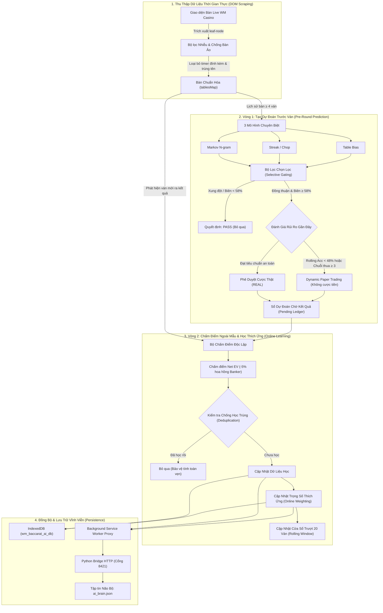

# Kiến Trúc Hệ Thống AI Baccarat (AI Architecture)

Tài liệu này mô tả chi tiết luồng dữ liệu, vòng đời hai pha (Two-Phase Learning Cycle) và vai trò của từng mô hình thành phần trong hệ thống AI Baccarat Thích Ứng Trực Tuyến (**Online Adaptive Multi-Model AI Engine**).

---

## 1. Sơ Đồ Luồng Dữ Liệu Tổng Thể (End-to-End Dataflow)

Hệ thống hoạt động theo chu trình khép kín: Quét bàn live &rarr; Tạo dự đoán trước ván &rarr; Đánh giá kết quả thực tế &rarr; Học thích ứng &rarr; Đồng bộ vào bộ nhớ vĩnh viễn.

---

## 2. Vai Trò Của Từng Mô Hình Thành Phần

Hệ thống không sử dụng một mô hình hộp đen đơn lẻ, mà kết hợp nhiều mô hình chuyên biệt thông qua một trọng tài điều phối thông minh:

### 2.1. Mô hình Chuỗi Markov (Hierarchical Backoff N-gram Model)
* **Vai trò:** Khai thác các mẫu hình thái xuất hiện lặp lại trong chuỗi kết quả ngắn hạn và trung hạn.
* **Nguyên lý:** Phân tích xác suất có điều kiện $P(\text{Next} \mid \text{Context})$. Ví dụ: Sau ngữ cảnh `[B, P, B]`, tần suất ván tiếp theo ra `B` hay `P` chiếm ưu thế.
* **Cơ chế Phân cấp (Hierarchical Backoff):**
  1. Quét tìm mẫu ở bậc cao nhất: bậc 4 ($N=4$).
  2. Nếu mẫu bậc 4 chưa xuất hiện đủ số lượng quan sát tối thiểu (`minSupport = 8`) hoặc xác suất phân vân (gần 50/50), mô hình tự động lùi về bậc 3 ($N=3$), bậc 2 ($N=2$) và bậc 1 ($N=1$).
  3. Áp dụng kỹ thuật làm mượt **Laplace Smoothing** ($\alpha = 0.5$) để tránh hiện tượng xác suất bằng 0 khi gặp tình huống hiếm.

### 2.2. Mô hình Nhịp Cầu & Bệt (Streak / Chop Learner)
* **Vai trò:** Nhận diện và theo dõi quán tính của thế trận: Thế cầu bệt (Streak) hoặc thế cầu đảo 1-1 (Chop / Ping-pong).
* **Nguyên lý:**
  - **Quán tính bệt (Streak):** Thống kê khi một cửa đã thắng $K$ ván liên tiếp (ví dụ Banker bệt 3 cây), tỷ lệ ván tiếp theo tiếp tục nối bệt (`continue`) so với bẻ cầu (`break`) là bao nhiêu.
  - **Nhịp đảo (Ping-pong):** Đếm tần suất đảo cửa liên tục `B-P-B-P` để dự đoán điểm gãy cầu.
* **Ngưỡng tin cậy:** Yêu cầu tối thiểu `minSupport = 6` quan sát tương tự.

### 2.3. Mô hình Xu Hướng Bàn (Table Bias Learner)
* **Vai trò:** Ghi nhận đặc tính riêng biệt của từng bàn cụ thể trong khay bài (shoe) đang chia.
* **Nguyên lý:** Mỗi khay bài thực tế có thể có sự lệch ngẫu nhiên cục bộ (ví dụ: một bàn có tỷ lệ Banker chiếm tới 65% trong 30 ván đầu).
* **Điều kiện kích hoạt:** Chỉ cung cấp tín hiệu khi bàn đã chơi tối thiểu **15 ván non-tie** trong khay hiện tại.

### 2.4. Trọng Tài Điều Phối Đa Mô Hình (Ensemble Manager)
* **Vai trò:** Thu thập dự đoán từ 3 mô hình con, cân nhắc độ tin cậy thích ứng và đưa ra quyết định cuối cùng.
* **Cơ chế Trọng số Động (Online Adaptive Weighting):**
  - Khởi điểm, các mô hình có trọng số mặc định (Markov: 0.40, Streak: 0.35, Table: 0.25).
  - Sau mỗi ván có kết quả thực tế, mô hình nào dự đoán đúng sẽ được tăng trọng số ($w \leftarrow w + 0.05$), mô hình nào đoán sai bị giảm trọng số ($w \leftarrow w - 0.05$).
  - Trọng số luôn được chuẩn hóa về tổng bằng $1.0$ và có sàn chặn dưới ($w \ge 0.10$) để không loại bỏ vĩnh viễn mô hình.
* **Bộ lọc kiểm duyệt (Selective Gating Engine):**
  - Chống xung đột: Markov báo B, Streak báo P &rarr; Lập tức **PASS**.
  - Biên an toàn: Xác suất kết hợp $< 58\%$ &rarr; Lập tức **PASS** (tránh phế 5% nhà cái).

### 2.5. Bộ Điều Khiển Trung Tâm (WMBaccaratAIEngine)
* **Vai trò:** Đóng vai trò nhạc trưởng điều phối toàn bộ vòng đời học và dự đoán.
* **Quản lý rủi ro:**
  - Theo dõi cửa sổ trượt 20 ván gần nhất (`rollingWindow`).
  - Kích hoạt **Dynamic Paper Trading** khi hiệu suất sụt giảm.
  - Kích hoạt **Stop-Loss** ngắt hoàn toàn khi gặp chuỗi thua liên tiếp $\ge 4$.
* **Đồng bộ tri thức:** Kết nối qua Background Service Worker để lưu trữ vào file `ai_brain.json`.
