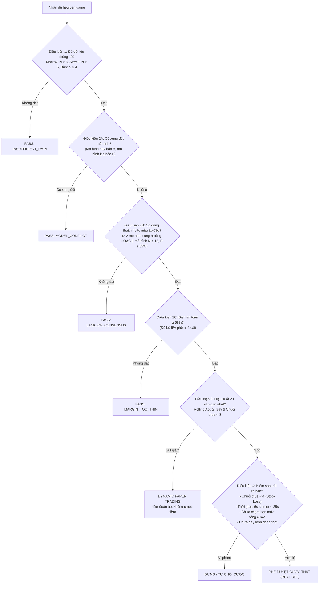

# Quy Tắc Ra Quyết Định & Kiểm Soát Rủi Ro (AI Decision Rules)

Tài liệu này quy định các tiêu chuẩn nghiêm ngặt để một tín hiệu dự đoán được phép chuyển thành lệnh cược thực tế, các trường hợp bắt buộc phải **PASS (Bỏ qua)**, cơ chế bảo vệ vốn **Dynamic Paper Trading** và các **Chốt chặn an toàn (Risk Guards)**.

---

## 1. Triết Lý Cốt Lõi: Quyền PASS Là Vũ Khí Tối Thượng

> Trong Baccarat, nhà cái thu phế 5% trên cửa Banker. Một hệ thống ép đặt cược liên tục ở mọi ván sẽ chắc chắn bị hao mòn vốn theo thời gian.
> **Quyền PASS (bỏ qua không cược)** chính là lá chắn hữu hiệu nhất giúp AI chỉ hành động khi có lợi thế thống kê rõ rệt.

---

## 2. Chi Tiết 4 Điều Kiện Chọn Lọc (Selective Gating)

### Điều Kiện 1: Đủ Dữ Liệu Quan Sát Tối Thiểu (Min Support)
AI tuyệt đối không tin vào một mẫu chỉ mới xuất hiện 1 hoặc 2 lần trong lịch sử:
* **Mô hình Markov (N-gram):** Mẫu ngữ cảnh (ví dụ chuỗi 3 ván trước) phải có tối thiểu **`minSupport = 8` lần xuất hiện** trong quá khứ.
* **Mô hình Streak:** Thế cầu bệt hoặc ping-pong tương tự phải có tối thiểu **`minSupport = 6` lần ghi nhận**.
* **Mô hình Bàn (Table Learner):** Bàn hiện tại phải có tối thiểu **15 ván non-tie** trong khay bài.
* **Ngưỡng ván tối thiểu của bàn:** Bàn game phải có tối thiểu **4 ván bài** ban đầu mới bắt đầu xem xét phân tích.

### Điều Kiện 2: Đa Mô Hình Đồng Thuận & Biên Lợi Thế
Một quyết định cược Banker hoặc Player chỉ được thông qua khi vượt qua 3 lớp phòng vệ:
1. **Phát hiện Xung đột Tín hiệu (`MODEL_CONFLICT`):**
   - Nếu Markov báo Banker nhưng Streak báo Player (hoặc ngược lại) &rarr; **Bắt buộc PASS ngay lập tức**.
   - Tuyệt đối không tung đồng xu hoặc ép chọn bên có xác suất nhỉnh hơn một chút.
2. **Kiểm tra Mức độ Đồng thuận (`LACK_OF_CONSENSUS`):**
   - Tiêu chuẩn lý tưởng là có từ **2 mô hình con trở lên** cùng chỉ về một cửa.
   - Nếu chỉ có duy nhất 1 mô hình con đưa ra tín hiệu, mô hình đó phải đạt tiêu chuẩn khắt khe: Số mẫu hỗ trợ $N \ge 15$ và xác suất $P \ge 62\%$. Nếu không &rarr; **PASS**.
3. **Biên An Toàn Tối Thiểu (`MARGIN_TOO_THIN`):**
   - Xác suất kết hợp của cửa được chọn phải đạt **tối thiểu $\ge 58\%$** ($P_B \ge 0.58$ hoặc $P_P \ge 0.58$).
   - Các mức xác suất mấp mé 51% – 55% đều bị loại bỏ vì lợi nhuận kỳ vọng quá mỏng, không đủ bù phí hoa hồng 5% của cửa Banker.

### Điều Kiện 3: Đánh Giá Hiệu Suất Gần Đây (Rolling Window & Dynamic Paper Trading)
Hiệu suất của AI không phải là hằng số cố định, mà dao động theo tính chất chu kỳ của các bộ bài:
* **Cửa sổ trượt 20 ván (`rollingWindow`):** Ghi nhận kết quả của 20 dự đoán gần nhất đã có kết quả thực tế.
* **Tự động kích hoạt Dynamic Paper Trading khi:**
  1. Tỷ lệ chính xác 20 ván gần nhất rơi xuống dưới mức sàn: **`rollingAccuracy < 48%`**.
  2. HOẶC đang gặp phải chuỗi thua liên tiếp: **`currentLossStreak >= 3`**.
* **Ý nghĩa của Paper Trading:**
  - AI vẫn tiếp tục quét bàn, ghi sổ dự đoán và tự chấm điểm để theo dõi thị trường.
  - Nhưng thuộc tính `shouldBet` bị khóa về `false` &rarr; **Không một đồng tiền thật nào bị đặt cược**.
* **Điều kiện Tự động Hồi phục về Real Trading:**
  - Hiệu suất trên cửa sổ 20 ván hồi phục đạt **`rollingAccuracy >= 55%`**.
  - ĐỒNG THỜI chuỗi thua liên tiếp đã bị ngắt: **`currentLossStreak == 0`**.

### Điều Kiện 4: Kiểm Soát Rủi Ro & Chốt Chặn Bàn (Risk Guards)
1. **Stop-Loss Khẩn Cấp:** Nếu chuỗi thua chạm mốc **4 ván liên tiếp** (`currentLossStreak >= 4`), hệ thống lập tức khóa quyền cược thật để bảo toàn vốn tuyệt đối.
2. **Cố Định Mức Cược (Flat Betting):**
   - Luôn luôn cược đúng 1 đơn vị chip cơ sở đã thiết lập.
   - **Nghiêm cấm tuyệt đối Martingale (Gấp thếp):** Gấp thếp trong Baccarat là nguyên nhân hàng đầu dẫn đến cháy tài khoản khi gặp chuỗi đen.
3. **Khung Giờ Đặt Cược An Toàn:**
   - Chỉ đặt cược khi bộ đếm thời gian của bàn nằm trong khoảng: **$6\text{s} \le \text{betTime} \le 25\text{s}$**.
   - Không cược khi bàn còn dưới 5 giây (tránh trễ mạng làm rớt tiền dở dang).
   - Không cược khi bàn chưa xác nhận mở bát (thời gian âm hoặc trạng thái rỗng).
4. **Hạn Mức Tổng Cược (Total Bet Limit):**
   - Khi tổng số tiền cược đã đặt trong phiên đạt hoặc vượt hạn mức cài đặt (mặc định 5.000 chip), bot tự động dừng lại và cảnh báo người dùng.
5. **Giới Hạn Lệnh Cược Đồng Thời (Concurrent Bet Limit):**
   - Chỉ cho phép tối đa từ **3 đến 5 lệnh cược** đang ở trạng thái PENDING cùng lúc. Tránh việc rải tiền vào quá nhiều bàn trong cùng 1 giây.
