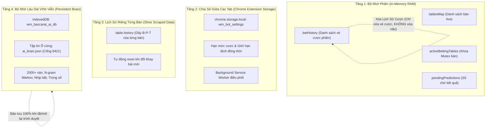
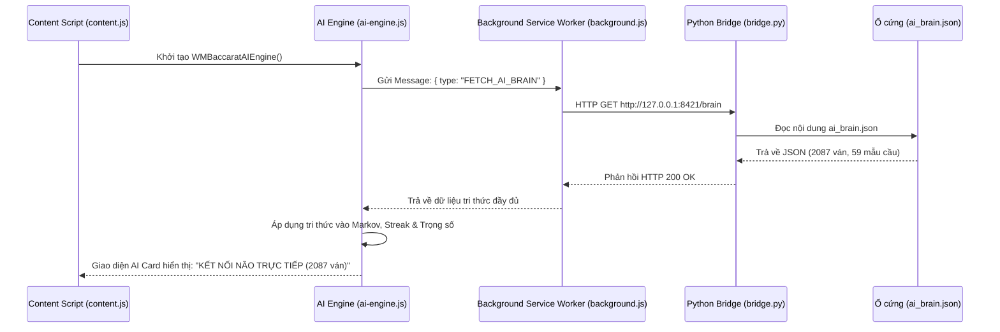

# Cơ Chế Bộ Nhớ & Tiến Trình Học Tập (AI Memory & Learning)

Tài liệu này giải thích cách dữ liệu được phân tầng, lưu trữ và khôi phục trong tiện ích, giúp hiểu rõ ranh giới giữa dữ liệu tạm thời trong phiên và tri thức vĩnh viễn của AI.

---

## 1. Phân Tầng Bộ Nhớ (4 Tầng Dữ Liệu Độc Lập)

Hệ thống quản lý dữ liệu thành 4 tầng riêng biệt để đảm bảo không bị lẫn lộn giữa sổ kế toán đặt cược và tri thức học máy:



---

## 2. Chi Tiết Từng Tầng Bộ Nhớ

### 2.1. Tầng 1: Bộ Nhớ Trong Phiên (In-Session / Runtime)
* **Vị trí lưu:** Bộ nhớ RAM của tiến trình JavaScript trên trang web WM Casino (`content.js`).
* **Các thành phần:**
  - `this.tablesMap`: Lưu trạng thái bàn game hiện tại (ID, tên bàn, thời gian đếm ngược, chuỗi ván hiện hành).
  - `this.activeBettingTables`: Danh sách ID các bàn đang trong quá trình gửi lệnh cược (In-flight Mutex) nhằm chống việc đặt tiền trùng lặp trên cùng một bàn.
  - `this.pendingPredictions`: Sổ ghi nhận dự đoán AI đã đưa ra trước khi bàn công bố kết quả.
  - `this.betHistory`: Danh sách các lệnh cược đã bấm trên web (thời gian, cửa cược, số tiền, trạng thái Thắng/Thua/Hòa).
* **Vấn đề hạn mức và nút "Xóa Lịch Sử Cược":**
  - Mảng `this.betHistory` dùng để tính **Tổng tiền cược đã đặt** nhằm so sánh với hạn mức (ví dụ: `4.000 / 5.000`).
  - Khi bấm nút **"Xóa Lịch Sử Cược"** trong tab Lịch Sử: **Chỉ có mảng `this.betHistory` bị làm rỗng**, đưa tổng tiền cược về `0` để người dùng cược tiếp. **Hoàn toàn KHÔNG ảnh hưởng hay làm mất bất kỳ dữ liệu học nào của AI.**

### 2.2. Tầng 2: Dữ Liệu Chia Sẻ Giữa Các Tab (Cross-Tab Extension Storage)
* **Vị trí lưu:** `chrome.storage.local` và tiến trình chạy ngầm `background.js`.
* **Mục đích:**
  - Lưu trữ cấu hình người dùng: Chip cược mặc định, Hạn mức tổng cược (Max Total Bet), Số lệnh cược tối đa cùng lúc (Max Concurrent Bets), Chế độ giao dịch (REAL hay PAPER TRADING).
  - Khi người dùng mở nhiều tab hoặc tải lại trang, các cài đặt này được nạp lại tức thì mà không cần thiết lập lại từ đầu.

### 2.3. Tầng 3: Lịch Sử Riêng Từng Bàn (Per-Table History)
* **Vị trí:** Thuộc tính `table.history` của từng bàn trong `tablesMap`.
* **Đặc tính:**
  - Được trích xuất theo thời gian thực từ thẻ DOM của sòng bài (dãy kết quả Banker, Player, Tie).
  - Độc lập giữa các bàn: Bàn Sexy Bac 1 có lịch sử riêng, Bàn Sexy Bac 2 có lịch sử riêng.
  - Khi dealer hoàn tất một khay bài (Shoe Reset) và bắt đầu khay mới, chuỗi lịch sử của bàn đó sẽ tự động bắt đầu lại từ ván 1.

### 2.4. Tầng 4: Bộ Nhớ Lâu Dài Vĩnh Viễn (Persistent AI Knowledge)
* **Vị trí lưu:** 
  1. Trình duyệt: Cơ sở dữ liệu `IndexedDB` mang tên `wm_baccarat_ai_db`.
  2. Ổ cứng máy tính: Tập tin `ai_brain.json` được quản trị bởi tiến trình dịch vụ ngầm `bridge.py` trên cổng `8421`.
* **Dữ liệu thực tế được lưu trữ:**
  ```json
  {
    "version": "2.0.0",
    "updatedAt": 1730198000000,
    "stats": {
      "totalRoundsObserved": 2087,
      "totalPredictionsEvaluated": 536,
      "correctPredictions": 274,
      "accuracy": 0.51119,
      "netUnitsWon": 1.25,
      "expectedValue": 0.00233
    },
    "markovNgrams": {
      "BPB": { "B": 12, "P": 5, "total": 17 },
      "PPPP": { "B": 65, "P": 42, "total": 107 }
    },
    "streakStats": {
      "B_3": { "continue": 24, "break": 18 },
      "P_4": { "continue": 12, "break": 15 }
    },
    "modelWeights": {
      "markov": 0.42,
      "streak": 0.38,
      "table": 0.20
    }
  }
  ```

---

## 3. Quy Trình Nạp Lại Tri Thức Khi Khởi Động (Hydration Flow)

Khi tiện ích mở lên hoặc trang web WM Casino được tải lại, tiến trình nạp não bộ diễn ra tự động theo thứ tự ưu tiên:



* **Cơ chế Dự phòng (Fallback):** Trong trường hợp Python Bridge chưa chạy hoặc cổng 8421 bị chặn, AI Engine tự động chuyển sang đọc từ `IndexedDB` nội bộ của trình duyệt, đảm bảo kiến thức đã tích lũy không bao giờ bị gián đoạn.
