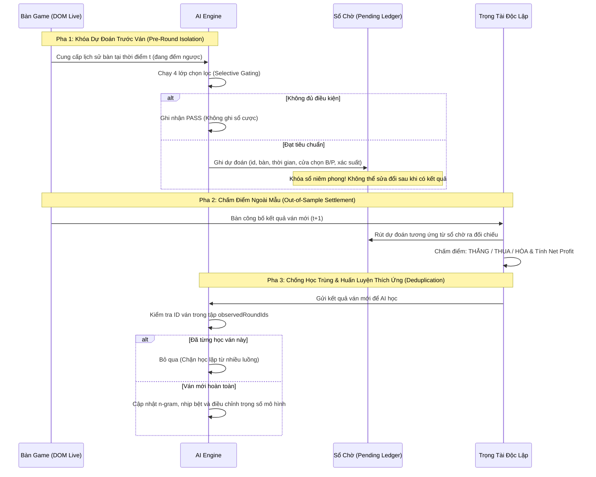

# Kế Hoạch & Quy Trình Kiểm Thử Đánh Giá Năng Lực AI (AI Evaluation Plan)

Tài liệu này xác lập quy trình kiểm nghiệm khoa học nhằm đánh giá năng lực thực tế của hệ thống AI Baccarat. Mục tiêu là đo lường hiệu quả dựa trên dữ liệu tương lai chưa từng được học, loại bỏ hoàn toàn hiện tượng học vẹt (Overfitting) và ảo tưởng về độ chính xác.

---

## 1. Nguyên Tắc Kiểm Nghiệm Bắt Buộc

> **NGUYÊN TẮC VÀNG:**
> 1. Không bao giờ đánh giá AI trên chính dữ liệu đã dùng để huấn luyện.
> 2. Không kết luận AI "thông minh hơn" hay "giỏi hơn" chỉ vì nó có thêm nhiều mô hình phức tạp.
> 3. Tỷ lệ thắng danh nghĩa $51\%$ không có ý nghĩa nếu không chứng minh được **Lợi Nhuận Ròng (Net Units P/L)** sau khi đã khấu trừ 5% hoa hồng cửa Banker.

---

## 2. Quy Trình Kiểm Thử 3 Pha (3-Phase Out-of-Sample Protocol)

Mọi bài kiểm thử năng lực AI phải tuân thủ nghiêm ngặt theo 3 bước tuần tự:

---

## 3. Các Chỉ Số Đo Lường Hiệu Năng Cốt Lõi (Evaluation Metrics)

Hệ thống đánh giá AI không dựa trên cảm tính, mà dựa trên bộ 4 chỉ số định lượng:

### 3.1. Độ Chính Xác Thực Tế Ngoài Mẫu (Out-of-Sample Accuracy)
$$\text{Accuracy} = \frac{\text{Số ván đoán đúng}}{\text{Số ván đoán đúng} + \text{Số ván đoán sai}} \times 100\%$$
*(Các ván ra Hòa - Tie được bảo toàn vốn, không tính vào mẫu số để đánh giá độ chuẩn xác nhị phân B vs P).*

### 3.2. Tỷ Lệ Chọn Lọc & Bỏ Qua (Pass Rate)
$$\text{Pass Rate} = \frac{\text{Số lần AI chủ động PASS}}{\text{Tổng số cơ hội quan sát}} \times 100\%$$
* Chỉ số này phản ánh tính kỷ luật của AI. Một AI chất lượng cao sẽ có Pass Rate từ $60\%$ đến $85\%$, chỉ chọn những ván có biên lợi thế vượt trội để giao dịch.

### 3.3. Lợi Nhuận Ròng Thực Tế (Net Units P/L)
Tính toán giá trị tài sản ròng sau khi đã chi trả đầy đủ chi phí sàn giao dịch:
* **Ván cược Banker Thắng:** $+0.95$ unit (đã trừ $5\%$ phí hoa hồng).
* **Ván cược Player Thắng:** $+1.00$ unit.
* **Ván cược Thua:** $-1.00$ unit.
* **Ván ra Hòa (Tie):** $+0.00$ unit (hoàn trả nguyên tiền).

$$\text{Net Units} = (0.95 \times \text{Banker\_Wins}) + (1.00 \times \text{Player\_Wins}) - (1.00 \times \text{Losses})$$

### 3.4. Kỳ Vọng Toán Học Trên Mỗi Lệnh Cược (Expected Value - EV)
$$\text{EV} = \frac{\text{Net Units}}{\text{Tổng số ván đã đặt cược}}$$
* $\text{EV} \le 0$: Hệ thống đang chịu lỗ phế hoặc không có lợi thế thống kê.
* $\text{EV} > 0$: Hệ thống thực sự có lợi thế vượt trội (Positive Alpha Edge) so với nhà cái.

---

## 4. Mốc Đối Chứng Chuẩn (Benchmark Baselines)

Để kết luận AI có giá trị thực sự hay không, kết quả của AI phải được so sánh đối chuẩn với 2 mốc cơ sở:

| Mốc Đối Chứng | Tỷ lệ Thắng Lý Thuyết | EV Kỳ Vọng Của Nhà Cái (House Edge) |
| :--- | :---: | :---: |
| **Tung đồng xu ngẫu nhiên (Random Guess)** | $50.00\%$ | $-2.50\%$ (Bị âm do phế Banker) |
| **Cơ sở Baccarat Lý thuyết (Không tính Tie)** | Banker: $50.68\%$ \| Player: $49.32\%$ | Banker: $-1.06\%$ \| Player: $-1.24\%$ |
| **Tiêu Chuẩn Đạt Chuẩn Của AI** | **$\ge 58.00\%$ (trên các ván đã lọc)** | **$\text{EV} \ge +0.10\text{ unit/bet}$** |

---

## 5. Danh Mục Các Kịch Bản Kiểm Thử Tự Động (Automated Test Suites)

Hệ thống đi kèm 6 bộ kiểm thử tự động, có thể chạy lại bất kỳ lúc nào bằng lệnh Node.js:

1. **[`test_ai_selective_gating.js`](file:///d:/tool%20game/tool%20wm/wmautofull/test_ai_selective_gating.js):**
   - Kiểm tra Điều kiện 1: Mẫu $N < \text{minSupport}$ bị từ chối 100%.
   - Kiểm tra Điều kiện 2: Xung đột tín hiệu (B vs P) bị hủy; Xác suất $< 58\%$ bị từ chối; Đồng thuận cao được phê duyệt.
   - Kiểm tra Điều kiện 3: Tự động hạ xuống Paper Trading khi hiệu suất gần đây sút giảm.
   - Kiểm tra Điều kiện 4: Chấm điểm chuẩn xác Net Units sau 5% phế Banker.
2. **[`test_ai_verification.js`](file:///d:/tool%20game/tool%20wm/wmautofull/test_ai_verification.js):**
   - Kiểm tra chống học trùng (Deduplication) khi nhiều luồng cùng gửi một ván bài.
   - Kiểm tra sinh dự đoán trước ván và so sánh với mức cơ sở 50%.
   - Kiểm tra tính bền vững của bộ nhớ khi tắt và bật lại tiện ích.
3. **[`test_table_detection.js`](file:///d:/tool%20game/tool%20wm/wmautofull/test_table_detection.js):**
   - Kiểm tra tách số đếm ngược timer ra khỏi tên bàn, dọn dẹp bàn ảo phantom.
4. **[`test_brain_sync.js`](file:///d:/tool%20game/tool%20wm/wmautofull/test_brain_sync.js):**
   - Kiểm tra quy trình nạp và lưu file `ai_brain.json` trực tiếp qua Background Proxy.
5. **[`test_max_bet_constraint.js`](file:///d:/tool%20game/tool%20wm/wmautofull/test_max_bet_constraint.js):**
   - Kiểm tra chốt chặn hạn mức tổng cược và giới hạn số lệnh cược đồng thời.
6. **[`test_bet_button_xpath.js`](file:///d:/tool%20game/tool%20wm/wmautofull/test_bet_button_xpath.js):**
   - Kiểm tra tính tương thích của XPath và ID nút cược Banker/Player trên WM Casino.
